# DAUREL V2 — Modelo lógico y revisión arquitectónica
**Estado:** diseño propuesto, pendiente de implementación | **Fecha:** 2026-10-24
**Fuente:** checkpoint maestro DAUREL 2026-10-24 y revisión del repositorio `SantiagoUtrilla/daurel-web`.

> **No es una migración SQL ni autoriza cambios en producción.** La base `daurel-staging` ya fue creada por el fundador; aún requiere Worker/frontend/secretos aislados. La tabla legacy `leads` permanece intacta.

## 1. Principios no negociables

1. Atención sin registro ni contraseña. Cuenta opcional y separada del cliente.
2. Una misma persona/empresa puede llegar por varios canales y abrir varias solicitudes.
3. Orígenes, solicitudes, conversaciones, actuaciones, contrataciones y pagos no se confunden.
4. Multidisciplina: las profesiones y servicios son catálogos, no condiciones jurídicas hardcodeadas.
5. Privacidad por diseño, autorización por recurso y auditoría de acciones sensibles.
6. Identificadores internos aleatorios no previsibles; folio `DAU-YYYYMMDD-####` meramente público.
7. Eventos de entrada idempotentes, cambios auditables, datos conservados con política de retención.
8. Modelo extensible hasta marketplace; implementación gradual con presupuesto inicial mínimo.
9. Legacy sigue operando hasta transición verificada; no se altera `daurel-db` por desarrollar V2.
10. Git versiona Worker, frontend, migraciones, políticas de acceso y documentación; secretos fuera del repositorio.

## 2. Modelo conceptual: núcleo

### A. Personas, organizaciones e identidad

| Entidad | Responsabilidad | Clave / vínculos |
|---|---|---|
| `parties` | Sujeto operativo único, incluso prospecto incompleto. `kind`: unknown/person/organization; `lifecycle` independiente del acceso digital. | `party_id` UUID; identificador interno estable. |
| `persons` | Atributos exclusivos de persona física, cuando se identifique. | `party_id` PK/FK a parties 1:0..1. |
| `organizations` | Datos opcionales de empresa/organización. | `party_id` PK/FK a parties 1:0..1. |
| `party_relationships` | Persona representante/empleada o vínculos entre organizaciones, con vigencia, autoridad y evidencia. | `from_party_id`, `to_party_id`, tipo/rol. |
| `party_contacts` | Múltiples teléfonos, correos, contactos preferentes o compartidos, normalización y verificación. | `contact_id`, `party_id` FK; no asumir teléfono único universal. |
| `external_identities` | IDs inmutables de Facebook, Instagram, WhatsApp API, etc., con ámbito de proveedor y cuenta de canal. | `party_id`; único por `provider+platform+channel_account+external_user_id` según semántica de proveedor. |
| `party_merge_history` | Registro reversible/dirigido de fusión validada; conservar IDs origen, destino, actor, evidencia y alias. | referencia a parties; no sobrescribir datos silenciosamente. |
| `accounts` | Acceso digital optativo; nunca requisito para crear party ni solicitud. | `account_id` independiente. |
| `auth_identities` | Correo confirmado, passkey u otros métodos de autenticación futuros. | account FK; no almacenar tokens en claro. |
| `account_party_access` | Permisos de cuentas sobre su persona y/o empresas que representan; revocables. | account FK, party FK, rol/acceso/alcance. |
| `sessions` / `verification_challenges` | Sesión y acceso por magic link con expiración, revocación, control antifraude; persistir sólo hashes de tokens. | account FK cuando aplique. |

**Decisión:** no crear una tabla `clients` paralela con teléfono/nombre duplicados; una party actúa como prospecto, cliente, profesional o empresa según sus roles y relaciones. Una empresa puede ser cliente y proveedora. El nombre de pantalla no es prueba de identidad. Un usuario de red social puede originar `party.kind=unknown` y completar su perfil después. El mismo contacto puede corresponder a varias parties (teléfono familiar o de negocio): coincidencia = candidato, no fusión automática.

### B. Captación y comunicación multicanal

| Entidad | Responsabilidad |
|---|---|
| `channel_accounts` | Cuentas operativas de DAUREL: Facebook Page, Instagram, WA Business, correo, etc.; external account id. |
| `integration_events` | Webhooks/entradas crudas **mínimas**, idempotencia por proveedor/cuenta/evento, estado, reintentos y fecha. |
| `conversations` | Hilo de origen; canal, cuenta operativa, ID externo, fecha y estado. |
| `conversation_participants` | Parties que participan en hilo; papel/visibilidad. |
| `messages` | Metadatos de mensaje, sentido, emisor, referencia a contenido, retención y estado; sin obligación de retener texto eternamente. |
| `conversation_request_links` | Enlace M:N: un hilo puede tratar varios asuntos y un asunto puede continuar en varios canales. |
| `touchpoints` | Historial de atribución inmutable: fuente, campaña, UTM, anuncio, referidor, canal y fecha. |

**Reglas:** guardar evento idempotente antes de producir efectos; asegurar unicidad de `provider+provider_account+provider_event_id` (o llave derivada confiable); reintentos nunca crean segundas solicitudes. Los IDs de redes suelen depender de la cuenta/app y no deben compararse globalmente. Una conversación puede comenzar sin teléfono, correo ni cuenta. `first_touch` se deriva del primer touchpoint real; `last_touch` del más reciente. Registrar consentimientos/capacidad de contacto según canal.

### C. Servicios, solicitudes y participantes

| Entidad | Responsabilidad |
|---|---|
| `professions` | Catálogo de disciplinas (Derecho, contabilidad, electricidad, etc.). |
| `specialties` | Catálogo de especialidades con profesión/jerarquía opcional. |
| `services` | Catálogo de servicios, modalidad, reglas de elegibilidad y estado. |
| `service_professions` | Enlace M:N para servicios interdisciplinares. |
| `service_requests` | Solicitud con ID interno aleatorio, `public_folio` UNIQUE, parte solicitante, servicio opcional, resumen, prioridad, urgencia, lugar/zona, timestamps y origen. |
| `request_participants` | Relación M:N party ↔ solicitud con roles: solicitante, beneficiario, representante, autorizado, empresa. |
| `request_states` | Vista materializada del estado actual **por dimensión**, no historia única: operativo, información/documental, contacto y cierre. Los estados de contratación y cobro viven en sus propias entidades. |
| `request_events` | Cronología append-only, actor, esquema/version, visibilidad, resumen, referencia a datos y correcciones. |
| `tasks` | Trabajo pendiente con responsable, estado, prioridad y vencimiento; no es lo mismo que evento. |
| `deadlines` | Plazos calculados vs revisados, fundamento, jurisdicción, zona horaria y validador responsable. |
| `reminder_rules` / `reminder_jobs` | Programación, próxima ejecución e idempotencia de seguimientos. |

**Cardinalidades principales:** party 1:N solicitudes en calidad de solicitante; parties N:M solicitudes por `request_participants`; servicio 1:N solicitudes (servicio puede quedar NULL mientras se identifica); solicitud 1:N eventos, tareas y plazos; solicitudes N:M conversaciones; conversación 1:N mensajes.

**Separación de estados:** solicitud registrada ≠ cliente identificado ≠ cotización aceptada ≠ pago recibido ≠ profesional asignado ≠ servicio completado. Evitar una sola máquina global imposible de mantener; definir transiciones por dimensión y por versión de workflow. Las funciones transversales deben producir eventos del dominio y actualizar vistas de estado en la misma operación transaccional cuando sea posible.

### D. Profesionales, organizaciones proveedoras y marketplace

| Entidad | Responsabilidad |
|---|---|
| `professional_profiles` | Perfil de prestador asociado a una party person, verificación, estatus y condiciones. |
| `professional_capabilities` | Profesión, especialidad, área de servicio, modalidad, acreditaciones y vigencias. |
| `provider_memberships` | Relación de profesional con organización proveedora (que también es party). |
| `professional_credentials` | Cédula/licencia/validaciones según profesión, verificador y vigencia, con documento privado opcional. |
| `request_assignments` | Historial de asignaciones, aceptación, rechazo, reasignación, fechas y actores; sin sobrescribir el anterior. |
| `assignment_candidates` / `service_offers` / `offer_responses` | Fase marketplace: filtros, propuesta, tiempos, aceptación y caducidad. |

**Restricciones:** validación de credenciales, jurisdicción, cobertura, consentimiento, disponibilidad y conflicto de interés antes de revelar datos. La solicitud puede requerir varios profesionales y/o especialidades; nunca asumir una sola asignación. El motor de matching se incorpora después sin cambiar identidad ni solicitudes.

### E. Cotización, contratación, pagos y documentos

| Entidad | Responsabilidad |
|---|---|
| `quotes` / `quote_versions` | Oferta económica revisable; importe, moneda, conceptos, vencimiento y aceptación de versión exacta. |
| `engagements` | Contratación efectiva distinta de la solicitud, condiciones/versiones legales, partes y alcance. |
| `charges` / `payments` / `refunds` | Importes, medios, referencias de transferencia/efectivo y conciliación; evitar booleano `paid`. |
| `commissions` / `provider_payouts` | Etapas futuras y sólo cuando se definan el modelo mercantil/fiscal y conciliación. |
| `documents` / `document_versions` | Metadata, uploader, ACL, versiones, retención y `storage_key`; bytes privados en R2 más adelante. |
| `legal_document_versions` / `consents` | Texto/version aceptada, fecha, finalidad, canal, evidencia y revocación aplicable. |
| `incidents` | Reclamaciones, cancelaciones, conflicto, no presentación, reembolso y reasignación. |

**Criterio contable:** amounts en unidades menores enteras o decimal preciso documentado, `currency` ISO, ajustes por registros compensatorios, jamás floats binarios para dinero. Monedas/tasas independientes por operación. Registro de pago interno **no es CFDI**.

### F. Notificaciones, controles y operaciones

| Entidad | Responsabilidad |
|---|---|
| `notifications` | Qué debe comunicarse, a quién y por qué evento. |
| `notification_deliveries` | Intento concreto por WhatsApp/correo/portal/Telegram, proveedor, estado, errores y reintentos. |
| `notification_preferences` | Preferencias por party/canal y restricciones de consentimiento. |
| `users_roles` / `roles` / `permissions` / `role_permissions` | RBAC de operadores; complementado por autorización de recursos y participación. |
| `audit_log` | Acciones sensibles, actor, recurso, hora UTC, resultado, IP minimizada/según política; no debe contener secretos. |
| `background_jobs` | Ejecución diferida/reintentos de acciones idempotentes, sin dependencia de computadora local. |

**Seguridad:** rol nunca basta por sí mismo. Un profesional sólo accede a lo que justifica asignación y su alcance; soporte no hereda permisos financieros. El frontend no decide autorización. El acceso sin cuenta se hace con token aleatorio de corta vida, hasheado, atado a la solicitud y a privilegios limitados, revocable, con límites de intentos. Jamás acceso por mero folio. Tokens de webhook y secretos en Cloudflare Secrets, no en GitHub.

## 3. Esquema lógico ER abreviado

```mermaid
erDiagram
  parties ||--o| persons : detalle
  parties ||--o| organizations : detalle
  parties ||--o{ party_contacts : tiene
  parties ||--o{ external_identities : posee
  parties ||--o{ party_relationships : participa
  accounts ||--o{ account_party_access : autoriza
  parties ||--o{ account_party_access : recurso
  accounts ||--o{ auth_identities : autentica
  channel_accounts ||--o{ conversations : recibe
  conversations ||--o{ messages : contiene
  parties ||--o{ conversation_participants : participa
  conversations ||--o{ conversation_participants : incluye
  service_requests ||--o{ request_participants : incluye
  parties ||--o{ request_participants : participa
  service_requests ||--o{ request_events : registra
  service_requests ||--o{ tasks : requiere
  service_requests ||--o{ deadlines : vigila
  service_requests ||--o{ conversation_request_links : enlaza
  conversations ||--o{ conversation_request_links : enlaza
  services ||--o{ service_requests : clasifica
  professions ||--o{ service_professions : ofrece
  services ||--o{ service_professions : requiere
  parties ||--o| professional_profiles : presta
  professional_profiles ||--o{ professional_capabilities : acredita
  service_requests ||--o{ request_assignments : asigna
  professional_profiles ||--o{ request_assignments : realiza
  service_requests ||--o{ quotes : cotiza
  service_requests ||--o{ engagements : contrata
  service_requests ||--o{ documents : documenta
  service_requests ||--o{ incidents : gestiona
  request_events ||--o{ notifications : produce
  notifications ||--o{ notification_deliveries : entrega
```

Este diagrama abstrae relaciones adicionales (pagos/contratos, versiones, roles). No implica que todas las tablas deban construirse en el primer despliegue.

## 4. Identificadores, concurrencia y reglas de integridad

- **ID interno:** UUID aleatorio generado con API criptográfica del Worker; `public_folio` conservado para humanos y con índice UNIQUE. Verificar que la numeración pública no colisione bajo concurrencia antes de implementar su generador.
- **Tiempo:** UTC consistente, presentación con zona local del cliente/profesional; registrar zona cuando una fecha normativa dependa de ella.
- **Deduplicación:** llave de webhook UNIQUE + coincidencia de identidad externa confiable en el ámbito correcto; teléfono, correo sin verificar, alias y nombres generan alertas, no merges automáticos.
- **Integridad:** FKs y constraints, índices para `public_folio`, contactos normalizados, ids externos, filtros operativos y fechas. En D1 los FKs se aplican; migraciones seguirán sistema oficial de Wrangler y se ensayarán en staging.
- **Concurrencia:** idempotencia y restricciones únicas protegen operaciones repetidas; no basta con comprobar `SELECT` antes del `INSERT`. Diseñar transición atómica o condición por versión para evitar perder cambios simultáneos.
- **Rastro:** `created_at`, `updated_at`, `created_by`, `schema_version`/origen cuando proceda. Eventos relevantes inmutables y correcciones asociadas. Prohibido guardar secretos o expedientes completos en logs.
- **Origen:** origin event/touchpoint enlazable para explicar de qué canal, anuncio o actor surgió cada solicitud.
- **Borrado:** retención/archivo/restricción por regulación y finalidad; identidad fusionada conserva auditoría pero no concede acceso cruzado implícito.

## 5. Plan de implementación sin romper producción

| Hito | Entregables | Requisito |
|---|---|---|
| 0. Seguridad y ambientes | Staging D1 (creada), Worker staging, frontend staging, secretos/pruebas separados; recuperar y versionar el código real del Worker legacy. | **Antes de ejecutar SQL** o exponer staging. |
| 1. Núcleo V2 | parties, persons/organizations, contacts, external identities, services/professions, requests, participants, events, integration_events. | Primeras migraciones versionadas sólo a staging, casos de prueba. |
| 2. Operación | admin V2, captura manual y multicanal, búsquedas, dedupe sugerida, tareas/deadlines, autorizaciones, auditoría. | Pruebas de concurrencia, permisos y rollback lógico. |
| 3. Cliente | consulta por token invitado, cuenta opcional magic link, documentos privados y notificaciones. | Verificación de acceso y retención. |
| 4. Profesionales | verificación, panel y asignación/reasignación con visibilidad limitada. | Revisiones de conflicto/interés y credenciales. |
| 5. Comercial | cotizaciones versionadas, contratos, registro manual de pagos, reportes. | Política operativa/fiscal y autorizaciones. |
| 6. Marketplace | elegibilidad, ofertas, aceptación, reputación, comisiones y pagos a prestadores. | Validación legal/fiscal/comercial específica. |

**Coexistencia:** legacy seguirá recibiendo clientes mientras no haya corte controlado. Crear un puente de importación con `legacy_request_map(legacy_source, legacy_id, v2_request_id, imported_at, checksum)`, único por identidad de origen. Hacer ensayo con datos sintéticos; después exportación segura, conciliación de conteos y períodos de coexistencia. Elegir una **fuente de escritura por etapa** y reintentos idempotentes; no instalar dual-write ingenuo hacia dos bases sin reconciliación.

## 6. Revisión arquitectónica crítica (antes de SQL)

| Prueba | Resultado | Resolución |
|---|---|---|
| Cliente sin cuenta ni número | CUBIERTA | party provisional + conversación/solicitud; cuenta posterior por vínculo verificado. |
| Persona, organización, representantes | CUBIERTA | parties + especializaciones + party_relationships. |
| Duplicados y canales | CUBIERTA | IDs externos con ámbito, sugerencia de merge, ingesta idempotente. |
| Un hilo para varios asuntos y un asunto en varios hilos | CUBIERTA | conversation_request_links M:N. |
| Multidisciplina/marketplace | CUBIERTA | catálogos M:N, perfiles, capacidades, ofertas futuras. |
| Varios profesionales, privacidad y conflictos | CUBIERTA EN DISEÑO | asignaciones históricas y autorización por recurso; construir tests antes de uso real. |
| Eventos, tareas, plazos, estados | CUBIERTA | entidades separadas, evolución por workflow y eventos inmutables. |
| Costo/cobro/documentación | CUBIERTA EN DISEÑO | cotizaciones/versiones, engagements, pagos y metadatos de R2; no implementar aún. |
| Internacionalización | CUBIERTA EN DISEÑO | país, región, moneda, zona horaria explícitos cuando corresponda. |
| Pruebas, backups, reversión | BLOQUEANTE DE DESPLIEGUE | staging completo, scripts, snapshot/export y plan de corte. |
| Recuperabilidad del backend actual | **BRECHA CONFIRMADA** | repo GitHub contiene sólo frontend en `public/`; Worker actualmente no versionado aquí. Versionar primero el código real sin secretos. |
| Validación del esquema legacy real | **PENDIENTE** | no inferir columnas SQL reales de `leads` únicamente por JS; inspeccionar Worker y estructura D1 de forma segura antes del puente. |
| Auditoría de permisos | PENDIENTE DE IMPLEMENTACIÓN | definir matriz de roles/recurso y pruebas negativas por API, no confiar en filtros visuales. |

**Veredicto:** arquitectura conceptual coherente y lista para traducir a esquema físico **cuando el entorno staging esté completo y el backend actual recuperado/versionado**. No se han aprobado ni ejecutado migraciones.

## 7. Inspección del código real (2026-10-24)

- GitHub `main` contiene `README.md` y `public/`, pero **no contiene código del Worker/backend ni `wrangler.jsonc`/config de backend**.
- `public/config.js` apunta al Worker de producción y contiene site key pública de Turnstile (una site key es pública por diseño; la secret key nunca debe entrar al frontend).
- `public/script.js` valida WhatsApp y privacidad, envía `POST /solicitudes` y espera `result.request_id`: mantener contrato legacy durante transición.
- `public/admin.js` consume `/admin/leads` y rutas de edición; utiliza clave temporal en `sessionStorage`: reemplazar en V2 por sesiones/roles, sin romper panel existente.
- **Acción manual siguiente:** recuperar el código fuente real del Worker que está desplegado en Cloudflare, sin copiar sus secrets, para consolidar infraestructura reproducible; crear también Worker y frontend staging completamente aislados.

## 8. Criterio de calidad y decisión

No implementar tablas hipotéticas sin caso de uso, pero reservar vínculos y claves que eviten reconstrucciones. El siguiente commit deberá contener: configuración del backend versionado, staging aislado y/o primeras migraciones, **sólo después de validar fuente real + entorno**. El frontend de producción y la base `daurel-db` no se alteran durante esta fase.
